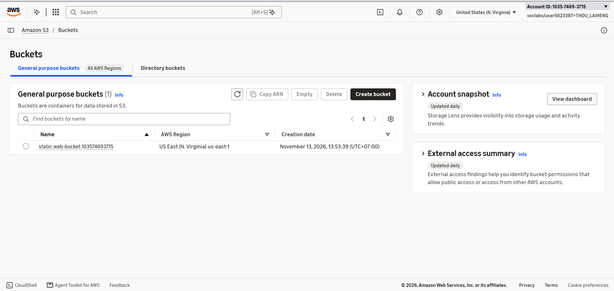
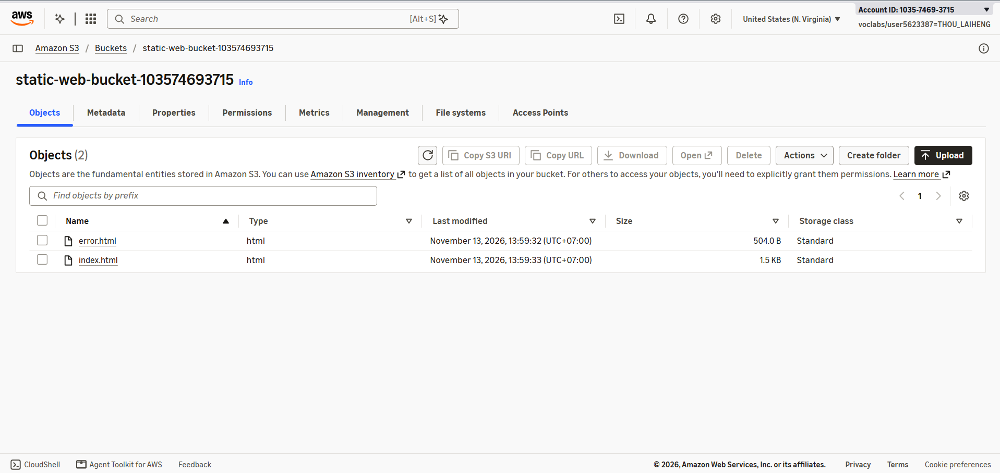
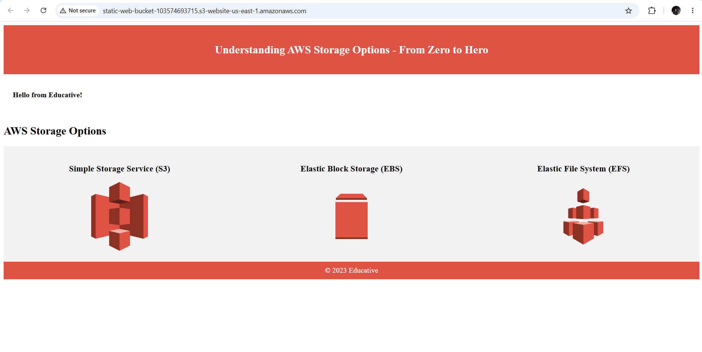
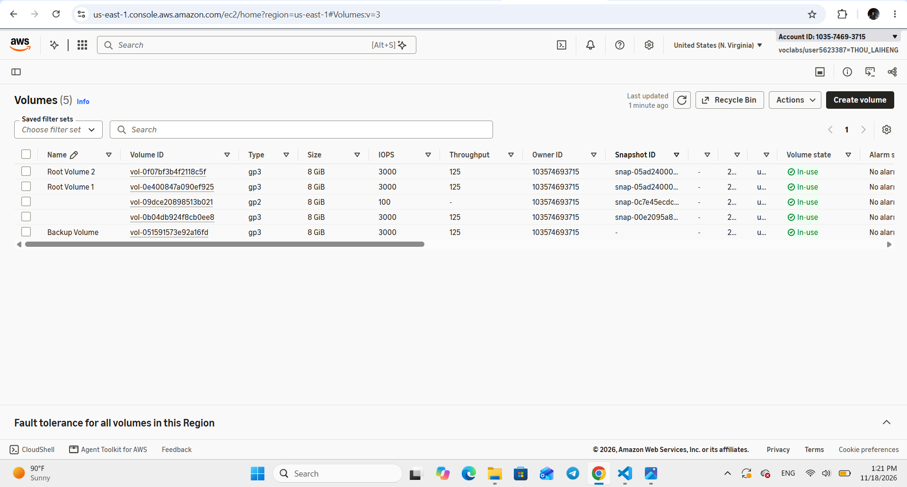
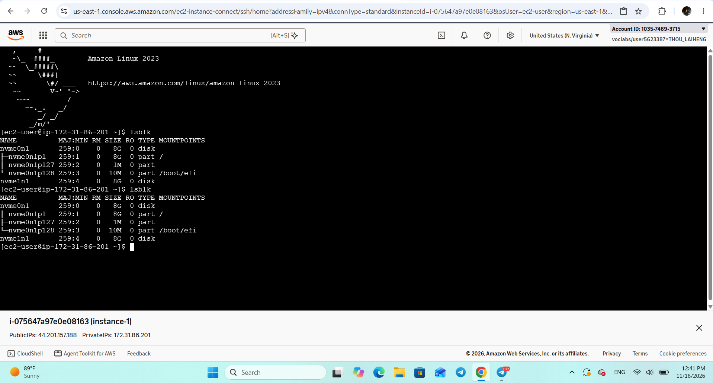
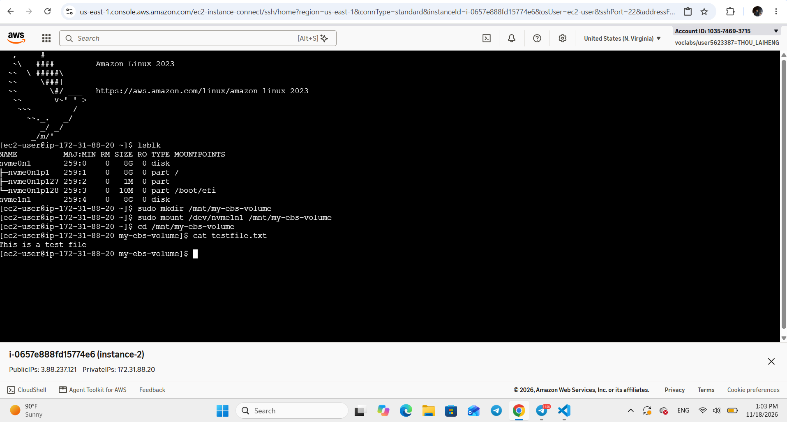
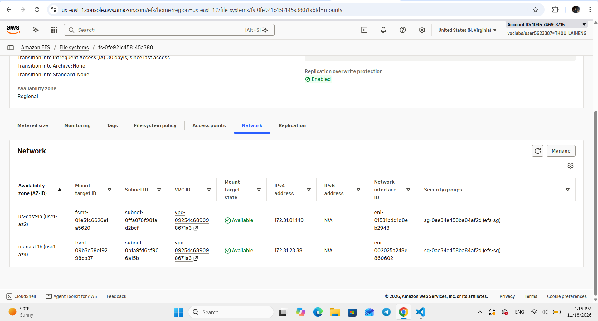
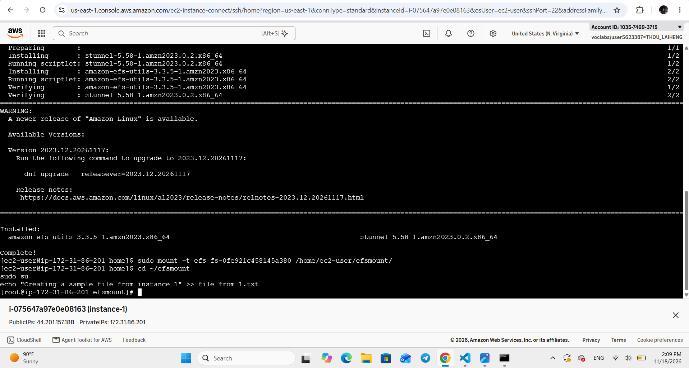
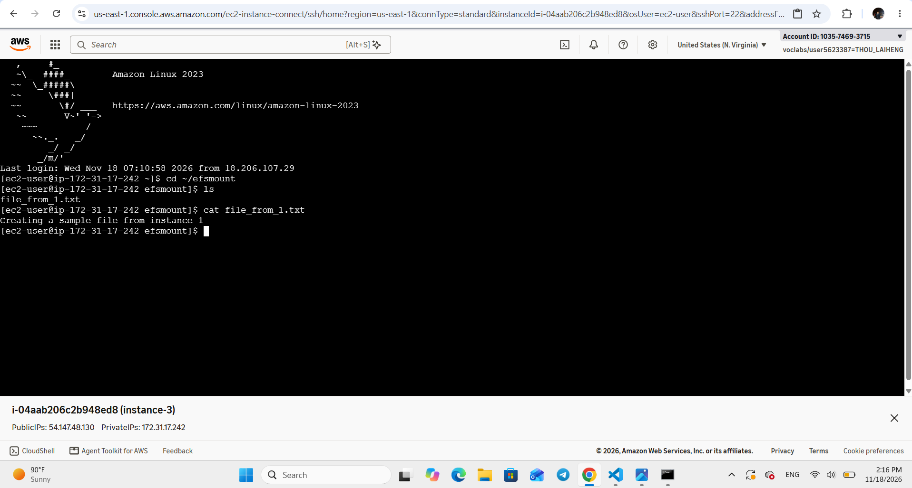

# Cloud Lab 3 Submission — AWS Storage Options

- **Student name:** THOU LAIHENG
- **Student ID:** e20220843
- **Learner Lab user name:** THOU LAIHENG
- **Date completed:** 13 November 2026

---

## Part 2.1 — Amazon S3

### Bucket list

### Uploaded files

### Static website

---

## Part 2.2 — Amazon EBS

### Volumes page

### Attached volume (`lsblk`)

Which device name did your volume get (`xvdf`, `nvme1n1`, ...)?

### File read on instance-2

---

## Part 2.3 — Amazon EFS

### File system and mount targets

### File created on instance-1

### File listed on instance-3

---

## Questions

1. After you turned on static website hosting, the endpoint first answered **403 Forbidden**. Why, and what changed after you added the bucket policy?  

   **Answer**: Turning on static website hosting created a website endpoint, but did not make the bucket's objects publicly readable. Without permission to retrieve the page and its assets, the endpoint returned **403 Forbidden**. The bucket policy granted public `s3:GetObject` access to the objects, so the browser could fetch them (provided S3 Block Public Access settings allowed that policy).

2. `testfile.txt` was still there after you moved Backup Volume to instance-2. What would have happened to a file saved on instance-1's root volume after terminating instance-1?  

   **Answer:** `testfile.txt` remained on **Backup Volume** because the file was stored on that separate EBS volume, which was detached from `instance-1` and attached to `instance-2`. A file saved on `instance-1`'s root volume would normally be deleted when the instance was terminated, because the root volume's **Delete on termination** setting is enabled by default. It would remain only if that setting had been disabled or the data had been backed up elsewhere.

3. Why did you run `mkfs` on instance-1 but not on instance-2? 

   **Answer:** `mkfs` creates a filesystem and overwrites filesystem metadata, so it was needed once when **Backup Volume** was new and blank on `instance-1`. The filesystem and `testfile.txt` stayed on the EBS volume when it was moved; running `mkfs` again on `instance-2` would have erased that data.
4. Why could instance-1 and instance-3 use the EFS file system at the same time, when an EBS volume had to be detached first? Why did they have to be in the subnets of the mount targets?

   **Answer:** EFS is a network file system, so multiple instances can mount and access it concurrently. A standard EBS volume is block storage and is generally attached to one instance at a time, so it had to be detached before it could be attached elsewhere. An EFS mount target provides a network endpoint in a subnet in its Availability Zone. The instances do not have to be in the exact same subnet, but they must be able to reach a mount target in the same VPC, and the security groups must allow NFS traffic on TCP port 2049. Using a mount target in the instance's own Availability Zone is recommended.
5. For each need, choose S3, EBS or EFS and give one reason: (a) a website's images, (b) the disk of a database server, (c) a folder shared by several web servers.

   **Answer:** (a) **S3** for a website's images: it stores objects durably and can serve them over the web. (b) **EBS** for a database server's disk: it provides block storage that can be attached to the server. (c) **EFS** for a folder shared by several web servers: multiple instances can mount the same file system at once.

## Clean up

- [x] Instances `instance-1`, `instance-2`, `instance-3` terminated.
- [x] `clab-efs` and **Backup Volume** deleted.
- [x] Security groups `efs-sg` and `ec2instances-sg` deleted.
- [x] S3 bucket emptied and deleted.